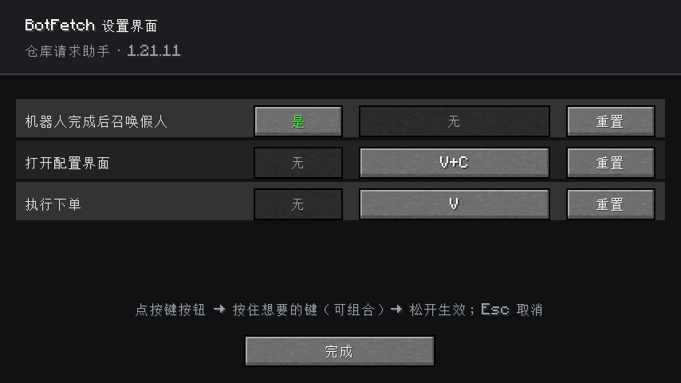
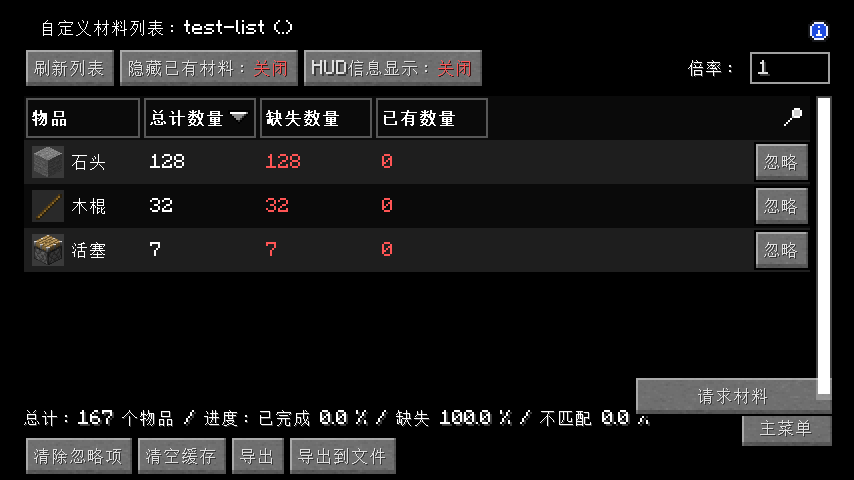

# BotFetch — 仓库请求助手

对准方块（或 Litematica 投影方块）按 **V**，自动向仓库机器人 `996_bot` 发
`/w 996_bot find <物品> <数量>`；机器人回复完成后，自动把收货假人 **kill + spawn**
到你脚下，右键它就能把货拿出来。

- Minecraft **1.21.11** / Fabric
- 纯客户端模组，不需要服务端装任何东西（只发聊天指令、监听聊天）
- 可选依赖 **Litematica**：装了就能对准投影里的幽灵方块下单，没装就只认真实方块
- 自带 masa 风格的配置界面（**V + C** 打开），中英双语，跟随游戏语言



---

## 下载

从 [Releases](https://github.com/yhaa233/botfetch/releases/latest) 下载 `botfetch-x.y.z.jar`，
放进 `.minecraft/mods` 即可（Fabric 1.21.11 + Fabric API）。

---

## 1. 依赖

| 必须 | 说明 |
|---|---|
| Fabric Loader ≥ 0.16 | |
| Fabric API | 1.21.11 对应版本（`0.141.x+1.21.11`） |

| 可选 | 说明 |
|---|---|
| Litematica 0.26.16（1.21.11 版） | 读取投影方块用；对应 malilib 0.27.19+ |
| Carpet | 服务端要有 `/player` 权限才能 kill / spawn 假人 |

## 2. 按键

| 操作 | 作用 |
|---|---|
| **V** | 下单（按下记录、松开时发送；按住 V 再按 C 会取消下单） |
| **V + C** | 打开配置界面 |
| **Alt + V** | 开/关「数量调节模式」，开启后滚轮改数量：±1，Shift ±10，范围 1～9999 |
| 滚轮（非调节模式） | 原版切快捷栏，模组不接管 |

按键都可以在配置界面里改（见下）。

## 3. 配置界面

按 **V + C** 打开，一行一个功能，左边名字、右边「开关 / 按键 / 重置」：

```
BotFetch 设置界面
────────────────────────────────────────────
机器人完成后召唤假人     [是/否]   [无]      [重置]
打开配置界面             [无]     [V+C]     [重置]
执行下单                 [无]     [V]       [重置]
────────────────────────────────────────────
点按键按钮 → 按住想要的键（可组合）→ 松开生效；Esc 取消
                              [完成]
```

- **机器人完成后召唤假人**：关掉之后只提示「取货完成」，不会 kill/spawn 假人。
- **打开配置界面**：支持 1～2 个键的组合。点按钮后按住想要的键，全部松开即生效；
  组合键就两个一起按住再松开。
- **执行下单**：只能绑单个键。
- 两个功能不能绑同一个单键，冲突会红字提示。
- 平时 HUD 不显示；只有调节模式、请求进行中或刚出结果时才出现状态条。

## 4. 材料清单一键请求

打开 Litematica 的材料清单界面，**右下角**会多出一个「请求材料」按钮：



点它会读出清单里所有「还缺」的材料（`MaterialListEntry#getCountMissing()`，同种物品自动合并），
按缺口数量逐个向 `996_bot` 下单：

- 一条一条发，等上一条回复再发下一条（机器人一次只能处理一个任务）；
- 全部发完后只 summon 一次假人，把货一次性带回来；
- 超过 `batchMaxItems`（默认 64）种时只取前 N 种，并在聊天栏提示；
- 清单里没有缺口、或有请求正在进行时，会在聊天栏提示。

## 5. 配置文件

界面改完会立刻写回 `config/botfetch.json`，也可以直接编辑：

```jsonc
{
  "botName": "996_bot",                                  // 机器人名字
  "requestCommand": "/w {bot} find {item} {count}",      // 下单模板
  "summonEnabled": true,                                 // 完成后召唤假人
  "killCommand": "/player {fake} kill",                  // 先 kill（保留背包）
  "spawnCommand": "/player {fake} spawn",                // 再 spawn 到自己脚下
  "fallbackFakePlayer": "qyb_botyong",                   // 回复里没写假人名时默认召唤谁；留空则跳过
  "summonDelayTicks": 20,                                // kill 与 spawn 间隔（20 tick = 1 秒）
  "requestKey": 86,                                      // 下单键（GLFW keycode，86 = V）
  "openConfigKeys": [86, 67],                            // 打开配置的组合键（86 = V, 67 = C）
  "count": 1,                                            // 当前数量
  "minCount": 1,
  "maxCount": 9999,
  "scrollStep": 1,
  "scrollShiftStep": 10,
  "hudEnabled": true,
  "projectionEnabled": true,                             // 读 Litematica 投影
  "reach": 6,
  "replyTimeoutSeconds": 600,
  "batchMaxItems": 64                                     // 材料清单一次最多排队多少种
}
```

- 物品按注册名发送，例如 `minecraft:sticky_piston`；`996_bot` 会自动去掉 `minecraft:` 前缀。
- 按键是 GLFW keycode（V=86、C=67、G=71…），一般用界面改就行。

## 6. 它是怎么判断「任务完成」的

认 `996_bot` 的 `find` 回复：

```
取到 1728/1728 个 黏性活塞，来自 1 个箱子，已放到假人 qyb_botyong 身上，用时 6s
```

优先从 `已放到假人 <名字> 身上` 里取名字；**如果机器人这条回复里没有这一段**
（旧版 `retriever.js` 的普通取货分支就不写），则退回 `fallbackFakePlayer` 配置的假人名。

机器人回复 `没取到 …`、`正在忙「…」`、`索引是空的…` 时，会在聊天栏提示失败，不召唤。

> 配套的 `996_bot` 已顺手修好（`src/retriever.js` 现在会把收货假人写进回复），
> 下次启动机器人后回复里就会带「已放到假人 xxx 身上」，不再依赖兜底配置。

## 7. 从源码构建

```powershell
# 需要 JDK 25（Loom 1.18 要求），产物在 build/libs/botfetch-0.3.1.jar
.\gradlew build
```

## 8. 已知限制

- 召唤依赖 `/player` 权限（OP 2 级以上）；没有权限时聊天栏会看到服务器报错。
- `996_bot` 每次任务结束会把自己召唤的假人清掉，所以 mod 发的 `kill` 多半是无操作，
  真正起作用的是 `spawn`；假人背包靠 Carpet 的 playerdata 保留。
- 投影判断是沿视线步进采样（0.05 格），不做精确碰撞盒射线；贴着斜面的极端情况可能差一格。
